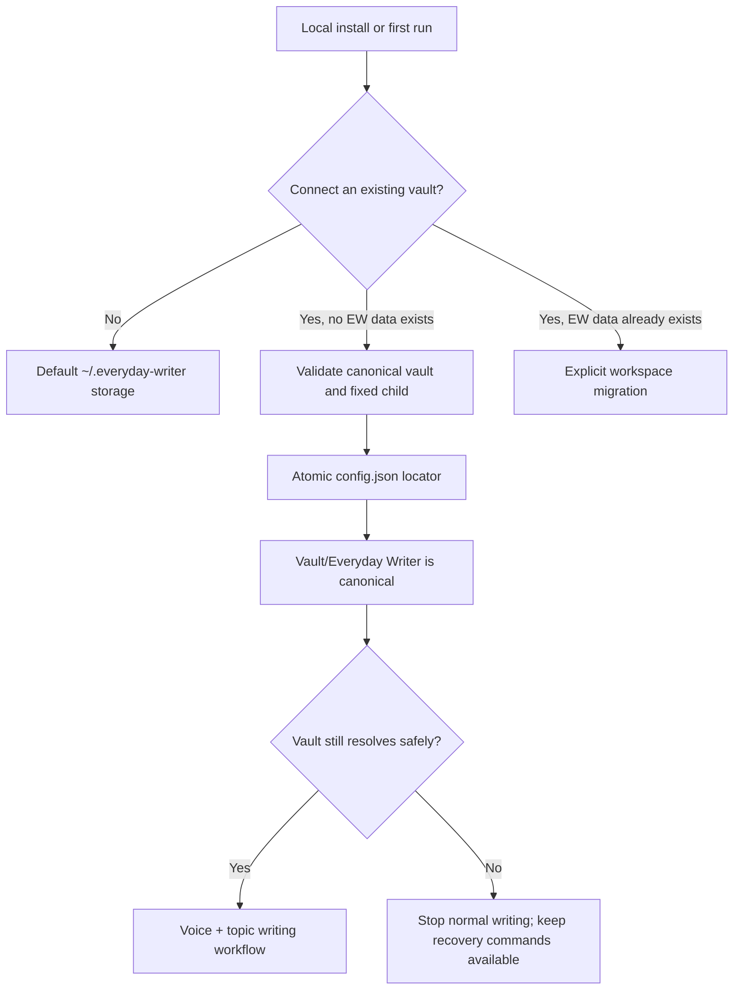

# EW — Everyday Writer


A writing skill system for professional writers, compatible with Codex, Claude Code, and Claude.ai Cowork.
Built on an A-Player standard: results over hours, own the outcome, no coinflipping critical components.

One root dispatcher, 13 writing sub-skills, one voice management skill, and one workspace management skill, all constrained by a voice fingerprint taken from your own writing and a set of anti-AI rules that get applied before anything ships.

Hold as many voices as you need — your own, plus a separate profile for every ghostwriting client. Switching is one command, and nothing bleeds between them.

---

## Creative writing and storytelling

Everyday Writer is also a **Claude creative writing skill**, **Claude script writing skill**, and **Claude storytelling skill** for people who want more than a prompt that says "write better." It gives Claude Code, Codex, or Claude.ai Cowork a full fiction workflow:

- **Storytelling:** turn a premise into an outline, pressure-test the conflict, and keep the character want/need visible
- **Creative writing:** draft fiction scenes and chapters with scene mechanics, point of view discipline, sensory grounding, and subtext
- **Creative newsletters:** write internet essays like silent scripts, with hooks, scene pressure, rehooks, spoken cadence, and payoff
- **Script writing:** write screenplay, TV, short film, YouTube, documentary, video essay, sketch, and short-form scripts with format rules, filmable action, hooks, dialogue, pacing, and viewer retention
- **World-building:** build a world bible, reverse-map existing drafts into characters and world facts, then capture new towns, factions, religions, rules, and lore into Obsidian-ready Markdown notes
- **Revision:** audit a draft against the voice profile and anti-AI writing rules before showing the final version

Searchers looking for a "creative writing skills Claude" setup usually want one of three things: a repeatable storytelling process, a script-writing skill with real screenplay constraints, or a worldbuilding memory that does not lose niche lore. EW now routes those requests directly instead of treating creative writing as one generic writing mode.

---

## Installation

Everyday Writer supports three environments:

- **Codex:** install as a local skill and invoke with `$ew`
- **Claude Code:** install through Claude's plugin marketplace or npm and invoke with `/ew`
- **Claude.ai Cowork:** upload the packaged cowork Markdown files to Project knowledge

The npm default install targets Codex. The Claude Code install path is still supported through `install:claude` and the `.claude-plugin/` marketplace manifests remain in the package.

### Beginner install

If you are technical, use the npm install path below. If you are not technical, use the Claude App custom-skill ZIP after it has been generated with `npm run package:claude-skill`, then upload it in Claude under **Customize → Skills** and enable Everyday Writer.

Codex/OpenAI native skill installation depends on the environment. The current supported local path remains `npx everyday-writer install`.

See [docs/distribution.md](docs/distribution.md) for the full distribution guide.

---

### Codex

Install the skill into your local Codex skills folder:

```bash
npx everyday-writer install
```

To connect a brand-new EW workspace in an existing Obsidian vault during installation:

```bash
npx everyday-writer install --vault "/absolute/path/to/My Vault"
```

The path must already be an Obsidian vault containing an ordinary, non-redirected `.obsidian/` directory. The vault, marker, and fixed `Everyday Writer/` child must resolve exactly where their lexical paths say they do. In an interactive terminal, the installer offers the same optional setup when `--vault` is omitted and storage is safe and empty; a yes followed by a blank path is rejected and re-prompted. Automated and piped installs, broken configuration, and existing bootstrap data never prompt. Existing bootstrap voices or writing are never hidden or merged.

A malformed, unsupported, disconnected, or unsafe storage locator does not prevent a plain package install/update. EW preserves it byte-for-byte, installs the package transactionally, prints a storage warning, and directs Codex users to `$ew:workspace ...` or Claude users to `/ew:workspace ...`. Explicit `--vault` is a storage mutation and therefore stops on those conditions.

Or globally:

```bash
npm install -g everyday-writer
everyday-writer install
```

This copies the skill into `~/.codex/skills/everyday-writer/`. User data lives outside that install: by default under the EW bootstrap directory, or inside an Obsidian vault when the user connects one during first-run onboarding. Reinstalling the skill never overwrites that writing calibration.

Use `$ew` to start, or call a sub-skill directly with `$ew:world-builder`, `$ew:scene-structure`, `$ew:linkedin`, and so on.

---

### Claude Code

Claude Code installs plugins from a marketplace. Two commands, run inside any session:

```
/plugin marketplace add Deupaxx/EveryDay-Writer
/plugin install ew@everyday-writer
```

Restart Claude Code (or run `/plugin` and reload) and the skills appear in the `/` menu as `/ew:linkedin`, `/ew:audit`, and so on.

To browse before installing, run `/plugin` and pick the marketplace from the menu.

---

### Claude.ai Cowork Mode

Cowork does not support file-based plugins. Use the pre-packaged files in [`cowork/`](cowork/) instead. They carry the YAML frontmatter Claude.ai expects.

1. Open the [`cowork/`](cowork/) folder in this repo
2. Upload `cowork/ew-master.md` to your Claude.ai Project (Settings → Project knowledge). That single file contains the Cowork system: all rules, voice profiling, 13 writing sub-skills, and memory-based voice management. Local workspace management is intentionally unavailable in Cowork.
3. Optionally add the individual `ew-*.md` files for the skills you use most. Each is self-contained.
4. Type `/ew [your request]` in the chat, or name the skill directly.

See [`cowork/README.md`](cowork/README.md) for the full file list.

Cowork stores your voice profiles in Claude.ai memory rather than on disk — one `EW Voice Profile — [Name]` memory per voice, plus an `EW Active Voice` memory holding the one in effect. Add `cowork/ew-voice.md` if you want the full voice-management flow.

---

### Claude Code npm install

For installs outside Claude Code's marketplace system, but still targeting Claude's plugin folder:

```bash
npx everyday-writer install:claude
```

Or globally:

```bash
npm install -g everyday-writer
everyday-writer install:claude
```

This copies the plugin into `~/.claude/plugins/ew/`. Note that a manual copy is not registered with the marketplace update flow, so use the marketplace method above unless you have a reason not to.

**Uninstall from Codex (npx install):** `npx everyday-writer uninstall`

**Uninstall from Claude Code (npx install):** `npx everyday-writer uninstall:claude`

If you installed the CLI globally, the bare equivalents are `everyday-writer uninstall` and `everyday-writer uninstall:claude`.

---

### Updating an existing install

The plugin is copied to your machine at install time and does not auto-update.

**Marketplace install:**
```
/plugin marketplace update everyday-writer
/plugin update ew@everyday-writer
```

**Codex npm install:**
```bash
npm install -g everyday-writer@latest && everyday-writer install
```

**Claude npm install:**
```bash
npm install -g everyday-writer@latest && everyday-writer install:claude
```

Check your installed version with `everyday-writer --version`.

**Upgrading from 0.2.0 →** your voice profile used to live at `core/voice-profile.md` inside the plugin. Updating replaces that directory, so copy the file somewhere safe first, then bring it across:

```
/ew:voice import <path-to-your-old-voice-profile.md>
```

If you've already updated and lost it, onboarding rebuilds it in about five minutes. Profiles now live under EW's resolved data root outside the plugin, which updates cannot touch.

---

## Multi-voice

One voice is active at a time and persists across sessions.

```
/ew:voice                     List voices, show which is active
/ew:voice writer-main         Switch — everything writes in this voice until changed
/ew:voice new                 Add a voice (yours, or a ghostwriting client's)
/ew:voice edit                Recalibrate the active voice
/ew:voice import <path>       Bring in a profile you already have
/ew:voice delete <name>       Remove one
/ew:voice repair <name>       Resume/repair a verified incomplete voice
```

## Optional Obsidian workspace

On the first local run, EW offers to connect an existing Obsidian vault before collecting writing samples. Declining keeps the default private bootstrap storage. Connecting creates a fixed `Everyday Writer/` workspace inside the vault, where voice profiles are viewable Markdown and finished interactive writing is organized into named topic projects with hubs, dated filenames, frontmatter, and real wiki links.

The npm installer can do the same initial connection with `--vault <path>`. It only configures a new or empty EW workspace; it never performs migration or merges existing data. The bootstrap locator remains at `~/.everyday-writer/config.json` so EW can find the vault from any working directory. Its first publication is exclusive and no-clobber, with file and directory durability flushes where supported. Without that file, EW falls back to `~/.everyday-writer/`. A configured vault that is missing, disconnected, malformed, or unsafe stops normal writing rather than silently falling back to a second copy, but it does not block a plain package update.

Package publication is transactional and recoverable, not a claim that an entire directory tree changes atomically. EW exclusively claims an absent destination directory, copies the validated staged tree, and writes the ownership receipt last. A failed or interrupted partial publication is quarantined; one verified prior backup is restored automatically, while multiple, malformed, redirected, or otherwise ambiguous recovery paths stop with their exact locations. Locks record a random token, PID, creation time, target, and operation. EW never breaks a lock by age: a live owner is preserved, a demonstrably dead owner is quarantined after identity-and-byte rechecks, and uncertain lock state fails closed with manual recovery guidance.

```text
<vault>/
└── Everyday Writer/
    ├── 00 - Everyday Writer Home.md
    ├── active-voice
    ├── voices/<voice-slug>/
    │   ├── voice-profile.md
    │   ├── references/
    │   └── samples/
    └── writing/<Readable Topic Name>/
        ├── 00 - <Topic Name> Hub.md
        ├── 01 - Project Brief.md
        ├── 02 - Decision Log.md
        ├── 03 - Open Questions.md
        ├── 04 - Idea Box.md
        ├── Drafts/
        ├── Notes/
        ├── Sources/
        └── Published/
```

Artifacts use readable date-prefixed names such as `2026-09-20 - The Cost of Consistency.md`; collisions receive ` - 2`, ` - 3`, and so on. Each artifact links to its full vault-root topic hub target, and the hub indexes the artifact, giving Obsidian real backlinks without linking every noun. Stable hubs and core notes are not date-stamped.

Privacy is a storage decision: Obsidian or another service may sync, back up, or share anything inside the vault. EW discloses that before an interactive connection. Uninstall disables the registered package path and keeps the verified package tree in the reported quarantine until you manually remove it; it also preserves `config.json`, legacy profiles, and all vault content.



Use `/ew:workspace status`, `/ew:workspace connect <vault>`, `/ew:workspace disconnect`, `/ew:workspace migrate <vault>`, `/ew:workspace topic new <name>`, and `/ew:workspace topic repair <name>` to manage it. EW never searches for vaults or creates `.obsidian/`. A missing or invalid configured workspace stops normal writing, while lifecycle commands remain available without requiring a working voice. Same-vault missing-workspace repair always inventories bootstrap first and warns that data may have been moved or lost; bootstrap data must go through explicit-source migration, while an empty replacement requires confirmation. Migration copies the complete selected managed workspace into an empty destination or exact byte-identical subset only—destination-only/different managed data stops because silent union/merge is unsupported.

**Write a single piece in another voice without switching:**

```
/ew:linkedin as client-acme
```

That applies to one invocation. The active voice is untouched.

**Adding a client.** `/ew:voice new` asks whose voice it is. Your own runs the standard seven-step onboarding, freewrite included. Someone else's runs a sample-analysis flow instead — you paste their published writing and confirm the read as their ghostwriter. There's no freewrite, because you can't ask an absent person for one, and the profile records `Confirmed by: ghostwriter, not subject` so that distinction survives.

Anything their samples don't support stays visibly `[bracketed]` rather than being filled in with a plausible guess. Prose shows how someone writes; it doesn't show what they want.

**Nothing bleeds.** Each voice owns its `references/`, `drafts/`, and `samples/`. A client's brand guidelines are read when their voice is active and at no other time.

**Drafts are tagged** with the voice they were written in — one line, no prompt:

```
Voice: client-acme

[draft follows]
```

---

## Invocation

| Command | Purpose |
|---|---|
| `/ew:ew` | Master entry point. Runs onboarding on first use, then dispatches to the right sub-skill. |
| `/ew:newsletter-creative` | Story-led newsletters, personal essays, narrative issues |
| `/ew:newsletter-technical` | Tutorials, analysis, industry breakdowns, data-led explainers |
| `/ew:linkedin` | LinkedIn posts and articles |
| `/ew:tweets` | Tweets and X threads |
| `/ew:substack-notes` | Substack Notes |
| `/ew:web-copy` | Landing pages, homepages, product marketing |
| `/ew:sales-copy` | Sales pages, email sequences, direct response |
| `/ew:outline` | Premise, idea, or story concept to usable structure |
| `/ew:scene-structure` | Fiction scenes, chapters, prose |
| `/ew:script-writing` | Screenplays, TV, YouTube, documentary, video essay, sketch, and short-form scripts |
| `/ew:world-builder` | World bible questioner, draft cartography, generator, Obsidian graph notes, and operation repair |
| `/ew:audit` | Before/after rewrite with failure analysis |
| `/ew:voice` | List, switch, add, import, recalibrate, delete, or repair voices |
| `/ew:workspace` | Inspect, connect, disconnect, migrate, organize, or repair the local Obsidian workspace |
| `/ew:failure-library` | Annotated AI-slop failure patterns |

You do not have to use the slash commands. Each skill carries a description, so asking for "a LinkedIn post about X" routes to the right one on its own.

In Codex, use the same names with `$` instead of `/`, for example `$ew` or `$ew:world-builder`.

Direct invocation skips routing, not constraints. Writing sub-skills still read the full core chain. Applicable recovery commands—including `/ew:voice repair`, `/ew:workspace topic repair`, and `/ew:world-builder repair <operation-id>`—bypass normal resolution and perform command-local safe validation.

### Storytelling workflow

For broad creative writing requests, EW routes across the fiction tools instead of guessing:

1. `outline` shapes the premise and story structure.
2. `world-builder` captures setting, factions, places, rules, religions, cultures, lore, and existing draft evidence.
3. `scene-structure` writes prose fiction scenes and chapters.
4. `script-writing` writes screenplays, TV scripts, YouTube scripts, video essays, documentaries, sketches, and short-form video.
5. `audit` revises existing drafts before final output.

---

## How it works

Every invocation runs the same sequence:

1. **Workspace resolution.** `core/obsidian-workspace.md` resolves default storage or a connected Obsidian workspace. Status, connect, disconnect, migrate, and topic repair bypass voice resolution so broken storage can still be inspected, moved, reconnected, or safely completed. Before connect or migration, EW warns that a vault may sync or be shared and identifies the profiles, client material, references, samples, drafts, and projects that can move; nothing is copied before confirmation.
2. **Voice resolution.** `core/voice-profile.md` is a resolver, not a profile — it points at the active voice beneath the resolved data root. If no voices exist, onboarding runs first. If resolution is ambiguous, EW stops and asks rather than guessing.
3. **Onboarding** (first run, and whenever you add a voice). Seven steps, about five minutes. You paste samples, answer questions about goals and platforms, do one freewrite, and confirm five voice adjectives. EW builds and verifies the complete profile, samples, and child folders in private staging, then publishes the voice tree at once; an interruption cannot turn a temporary directory into a voice. Connected mode indexes the verified profile from the EW home note and reports a repairable pending state if that second publication races with another edit.
4. **References check.** Any `.md` file in that voice's `references/` folder is read and takes precedence over sub-skill defaults.
5. **Dispatch.** The sub-skill reads `core/runtime-contract.md`, `core/obsidian-workspace.md`, the anti-AI core, the resolved voice profile, active voice reference files, and its own instructions before it writes.
6. **Two-pass loop and persistence.** No first draft is presented. In connected mode, completed interactive work is saved to its explicit or clearly matching topic; an explicitly requested new named topic can be created safely. Topic trees are staged before publication, and artifact-plus-hub and topic-plus-home updates are verified as recoverable pairs rather than claimed complete after only one file changes. Embedded output is never auto-saved.

### Obsidian story folders

`$ew:world-builder` can create Obsidian-ready Markdown when you give it both the explicit existing vault root and a contained story folder. It validates each path component and writes a story hub, world bible, continuity log, open questions note, idea box, and linked entity notes for characters, places, factions, cultures, religions, rules, timeline events, and important objects. A plain non-vault folder gets one portable `World Bible.md` with ordinary headings—no wiki links, frontmatter, entity-note tree, or graph/backlink promise.

The graph is plain Markdown: notes use unambiguous vault-root folder-qualified links like `[[Fiction/The Glass City/Characters/Maren Vale|Maren Vale]]`, frontmatter properties and tags for filtering, and backlinks between people, places, factions, cultures, religions, rules, and events. No Obsidian plugin is required.

Fast capture is built for mid-draft ideas. Drop a fragment like "add a town called Trojan Scape in the North, under the Starks, where the old religion was practiced" and world-builder will transactionally create or update the town note, preserve one raw thought in `04 - Idea Box.md`, link it with full targets such as `[[Fiction/Example Story/Places/The North|The North]]`, `[[Fiction/Example Story/Factions/House Stark|House Stark]]`, and `[[Fiction/Example Story/Religions/Old Gods|Old Gods]]`, and add useful tags such as `ew/place/town` and `ew/region/north`. Multi-note changes preflight their full write set, use an operation journal and idempotent markers, and become complete only after graph/index verification; `/ew:world-builder repair <operation-id>` resumes a recoverable interruption without duplicating the Idea Box entry.

Draft cartography is built for writers who already have pages. Give `$ew:world-builder` chapters, scenes, scripts, or a manuscript file and ask it to map the draft; it will extract characters, places, factions, rules, objects, timeline events, relationships, continuity facts, contradictions, and open threads. If you provide the explicit Obsidian vault root and contained story folder, it also writes `05 - Draft Map Report.md`, updates the hub, and creates or updates linked entity notes from evidence in the draft.

### Three rules that govern everything

- **Precedence** (`anti-ai-rules.md` §0.1). Your voice profile outranks the system's style rules, and a sample you paste outranks the profile. The rules strip machine defaults, not you.
- **No fabrication** (§0.2). Nothing gets a name, number, date, quote, or source you didn't supply. Missing details come back as visible `[brackets]`, never as invented specifics.
- **Restraint** (§9 and §10). Tells are counted in clusters, not instances, and the things that prove a human wrote something are protected from the edit.

---

## System Map

```
EW/
├── README.md
├── CLAUDE.md                          ← Guidance for Claude Code when editing this repo
├── SKILL.md                           ← Master dispatcher (skill name: ew)
│
├── agents/
│   └── openai.yaml                    ← Codex UI metadata and invocation policy
│
├── .claude-plugin/
│   ├── plugin.json                    ← Plugin manifest
│   └── marketplace.json               ← Marketplace manifest
│
├── bin/
│   ├── install.js                     ← npm install/uninstall CLI
│   └── check.js                       ← Package validator (npm run check)
│
├── core/
│   ├── runtime-contract.md             ← Short operating contract and read order
│   ├── obsidian-workspace.md           ← Storage resolution, topic layout, naming, links
│   ├── anti-ai-rules.md               ← The operating standard, precedence, fabrication
│   │                                    rule, banned patterns, checklists, restraint
│   ├── ai_slop_commandments.md        ← Mechanism reference + era-indexed slop vocabulary
│   ├── voice-profile.md               ← RESOLVER. Not a profile — points at the active
│   │                                    voice under the resolved data root
│   └── voice-profile-template.md      ← Blank fingerprint each new voice is stamped from
│
├── onboarding/
│   ├── ONBOARDING.md                  ← Environment detection and voice routing
│   ├── claude-code-mode.md            ← 7-step active onboarding, your own voice
│   ├── subject-mode.md                ← Sample-only onboarding, someone else's voice
│   └── claude-ai-cowork-mode.md       ← Memory-based onboarding (Claude.ai)
│
├── skills/
│   ├── newsletter-creative/SKILL.md
│   ├── newsletter-creative/scripted-essay-reference.md
│   ├── newsletter-technical/SKILL.md
│   ├── linkedin/SKILL.md
│   ├── tweets/SKILL.md
│   ├── substack-notes/SKILL.md
│   ├── web-copy/SKILL.md
│   ├── sales-copy/SKILL.md
│   ├── scene-structure/SKILL.md
│   ├── script-writing/
│   │   ├── SKILL.md
│   │   └── craft-reference.md         ← Feature, TV, YouTube, video essay,
│   │                                    documentary, sketch, short-form rules
│   ├── world-builder/
│   │   ├── SKILL.md
│   │   ├── questioner.md              ← Layered question sequence
│   │   ├── skeleton-template.md       ← World bible output template
│   │   ├── obsidian-output.md         ← Obsidian folder, note, and graph rules
│   │   └── manuscript-ingest.md       ← Existing draft to world graph mapping
│   ├── audit/SKILL.md
│   ├── outline/SKILL.md
│   ├── failure-library/SKILL.md
│   ├── voice/SKILL.md                 ← Voice management (/ew:voice)
│   └── workspace/SKILL.md             ← Vault, migration, and topic management
│
├── cowork/                            ← Claude.ai Cowork port (16 files, YAML frontmatter)
│   ├── README.md
│   ├── ew-master.md                   ← Whole system in one file
│   └── ew-*.md                        ← One file per sub-skill
│
├── references/                        ← Deprecated drop zone. Redirect note only —
│   └── DROP-MD-FILES-HERE.md            reference files now live per-voice
│
└── resources/                         ← Background reference material, not part of dispatch
```

Your voices live outside the repo, so plugin updates cannot wipe them. With no vault connection, the resolved data root is the bootstrap directory shown below. In connected mode, the equivalent tree lives under `<vault>/Everyday Writer/`, alongside the home note and `writing/` topic tree.

```
~/.everyday-writer/                    Windows: %USERPROFILE%\.everyday-writer\
├── active-voice                       One line: the voice currently in effect
└── voices/
    ├── writer-main/
    │   ├── voice-profile.md           The fingerprint
    │   ├── references/                Brand docs, style guides for this voice
    │   ├── drafts/                    File-mode output
    │   └── samples/                   Writing the profile was built from
    └── client-acme/
        └── ...
```

---

## Developing

There is no build step. Skills are markdown instruction files.

Before publishing, run the validator:

```bash
npm run check
```

It catches the failure modes that silently break plugin discovery: a skill file missing YAML frontmatter, a manifest in the wrong place, version drift between `package.json` / `plugin.json` / `marketplace.json`, and any registered sub-skill that has dropped one of the five core contracts (runtime, workspace, anti-AI rules, slop-pattern diagnostics, and voice resolution). `npm test` exercises installer storage safety in isolated temporary homes. Both the tests and package checks run automatically on `npm publish`.

**Releasing:**

```bash
npm version patch        # or minor / major
git push --follow-tags
```

Pushing a version tag publishes to npm. Bump the version in `.claude-plugin/plugin.json` and `.claude-plugin/marketplace.json` in the same commit; `npm run check` fails the publish if they drift.

---

## Design decisions

- **Skill name is `ew`**, not `everyday-writer`, for a shorter invocation path.
- **Codex installs to `~/.codex/skills/everyday-writer/`** and reads `agents/openai.yaml` for UI metadata.
- **The manifest lives in `.claude-plugin/`**, which is where Claude Code looks. A root-level `plugin.json` is ignored.
- **Every skill file carries YAML frontmatter.** Without `name` and `description`, Claude Code does not register the skill at all.
- **`core/` files are dependencies, not skills.** Every sub-skill names the runtime, workspace, anti-AI, slop-pattern, and voice contracts; none of them is invoked directly.
- **`core/voice-profile.md` is a resolver, not a profile.** Registered sub-skills depend on it and `core/obsidian-workspace.md`; the validator errors when either dependency disappears.
- **Voices live under the resolved data root, not in the plugin.** Default mode uses the EW bootstrap directory; connected mode uses `<vault>/Everyday Writer/`. The plugin directory is a replaceable public cache.
- **Reference material is per-voice.** A shared folder means a client's brand guidelines and yours get read together on every invocation. Per-voice folders make that impossible rather than merely unlikely.
- **Onboarding splits twice** — by environment (file-based in Claude Code, memory-based in Claude.ai) and by subject (your own voice gets a freewrite; someone else's can't have one).
- **The anti-AI rules include a restraint half.** A banlist applied without judgment produces prose stripped of whatever made it a person's. Sections 9 and 10 exist to stop that.

---

## License

MIT
